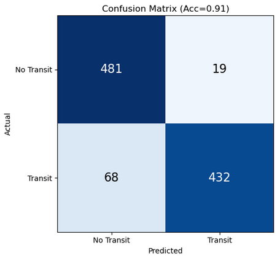
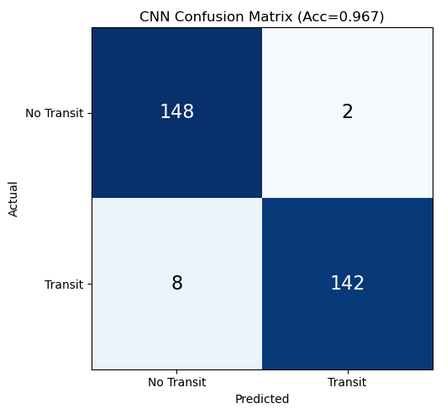
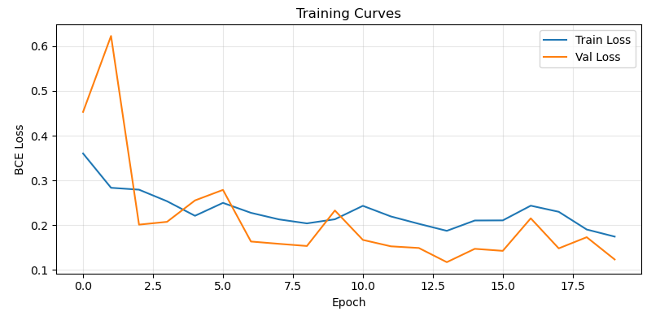

# UMBRA

**Deep learning detection of exoplanet transits in PSLS-simulated PLATO light curves**

[](https://master-mass.eu/)
[](https://doi.org/10.13140/RG.2.2.31127.74407)
[](https://doi.org/10.5281/zenodo.19715574)
[](LICENSE)

This project compares two methods for detecting planetary transits in simulated
PLATO light curves: the Box Least Squares (BLS) algorithm and a ResNet-1D
convolutional neural network. Both are tested on 1000 PSLS simulations. The CNN
reaches 96.7% accuracy and 98.6% precision, compared with 91.3% accuracy for BLS.
Both methods lose sensitivity for long-period planets that produce only one or
two transits in the 267-day observing window.

**Author:** Zain Ul Abideen, Erasmus Mundus MASS programme
**GitHub repository:** [dominuszain/CompAstroBio](https://github.com/dominuszain/CompAstroBio)

## Results

| Method | Accuracy | Confusion matrix |
|---|---|---|
| BLS | 91.3% |  |
| ResNet-1D CNN | 96.7% |  |



The full analysis is in `BLS/bls_transit_detection.ipynb` and
`CNN/cnn_resnet_transit.ipynb`. The report is in `Docs/report.pdf`.

## Repository contents

| Path | Contents |
|---|---|
| `demo_bls.ipynb` | Short BLS demo on the included sample |
| `demo_cnn.ipynb` | Short CNN demo on the included sample |
| `full_bls_results.ipynb` | BLS run on the full 1000-light-curve dataset |
| `full_cnn_results.ipynb` | CNN run on the full 1000-light-curve dataset |
| `BLS/` | BLS analysis notebook and notes |
| `CNN/` | ResNet-1D analysis notebook and notes |
| `dataset/sample/` | 100 simulated light curves used by the demos (about 1.1 GB) |
| `dataset/psls.yaml` | PSLS configuration used to generate the data |
| `dataset/script.sh` | Script that produced the dataset |
| `Task01/` to `Task04/` | Course task reports and the full metadata table |
| `Docs/` | Project report and figures |
| `Tests/` | Notebook execution and style checks |

The sample directory holds 50 transit and 50 non-transit light curves, which is
enough to run both demo notebooks end to end.

## Installation

```bash
python3 -m venv .venv
source .venv/bin/activate
pip install -r requirements.txt
```

The CNN demo uses PyTorch and runs on a laptop CPU. No GPU is required.

## Running the demos

Open `demo_bls.ipynb` or `demo_cnn.ipynb` in Jupyter and run all cells. If you
move the dataset, update the `DATA_DIR` path at the top of each notebook.

## Full dataset

The complete 1000-light-curve dataset (about 33 GB uncompressed, archived as an
11 GB zip) is available on Zenodo:

[](https://doi.org/10.5281/zenodo.19715574)

The data were generated with the PLATO Solar-like Light-curve Simulator (PSLS)
using `dataset/psls.yaml` and `dataset/script.sh`. The full per-run metadata is
in `Task04/metadata.csv`.

## Tests

```bash
pip install pytest nbmake nbqa pylint
bash Tests/test_nbmake.sh
bash Tests/test_pylint.sh
```

## Citation

If you use the code, paper, or dataset, please cite:

```bibtex
@misc{ulabideen_umbra_2026,
  author = {Ul Abideen, Zain},
  title  = {Deep Learning Detection of Exoplanet Transits in PSLS-Simulated PLATO Light Curves},
  year   = {2026},
  doi    = {10.13140/RG.2.2.31127.74407},
  url    = {https://doi.org/10.13140/RG.2.2.31127.74407}
}

@dataset{ulabideen_umbra_dataset_2026,
  author    = {Ul Abideen, Zain},
  title     = {PSLS-based computations for exoplanet transits},
  year      = {2026},
  publisher = {Zenodo},
  doi       = {10.5281/zenodo.19715574},
  url       = {https://doi.org/10.5281/zenodo.19715574}
}
```

## License

The code is released under the [MIT License](LICENSE). The simulated dataset and
notebook outputs are released under [CC BY 4.0](LICENSE-DATA).

## Acknowledgements

Produced for the Computational Astrobiology course in the MASS programme
(University of Belgrade, 2026).
